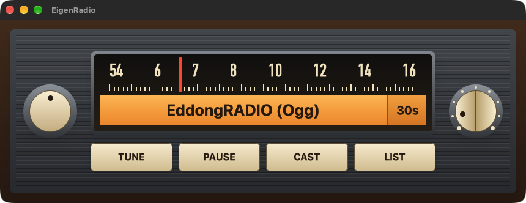

# EigenRadio

An internet radio for your desktop that looks and behaves like a 1960s car radio. It hops between stations at random, tuning through static on the way.



It is a Rust rewrite of [EigenRadio 2](https://github.com/ohnotnow/eigen2). The original needs Python, FFmpeg and a terminal. This one is a single app with nothing else to install.

It runs on Apple Silicon Macs for now.

## What it does

The controls:

- TUNE hops to another station straight away.
- PAUSE stops the music. PLAY finds a new station.
- CAST serves what you are hearing as a live MP3 stream.
- LIST opens a playlist file.
- The left knob mutes the speakers.
- The right knob sets how long each station plays, from 15 seconds to an hour. Click its left half for shorter and its right half for longer. The setting shows at the end of the amber display.

A station that fails is left alone for three days and then tried again. Three failures with no successful play in between and it is dropped for good.

It plays MP3, AAC, Ogg Vorbis and FLAC streams. HE-AAC streams play but sound duller, and Opus streams are skipped.

## Install

Download the zip from the [releases page](https://github.com/ohnotnow/eigenrust/releases), unzip it, and move EigenRadio to your Applications folder.

The first time you open it macOS will say it cannot be verified. To allow it:

1. Try to open EigenRadio once, and dismiss the warning.
2. Open System Settings and go to Privacy & Security.
3. Scroll down to the message about EigenRadio and choose Open Anyway.

## Playlists

EigenRadio comes with 81 stations built in. To use your own, press LIST or drop a file on the window. It reads `.m3u` playlists and Icecast directory `.xml` files, such as the one at <https://dir.xiph.org/yp.xml>. Your choice is remembered.

## Casting

Press CAST and the amber display shows an address, `http://127.0.0.1:8090/stream`. Click the display to copy it, then open it in any player that takes a stream address, such as VLC.

Another device can reach it by using your Mac's address in place of `127.0.0.1`.

## Building from source

### Prerequisites

- Apple's command line developer tools: `xcode-select --install`
- Rust: `brew install rust`

### Getting started

```bash
git clone https://github.com/ohnotnow/eigenrust.git
cd eigenrust
cargo run --release --features runtime-shaders
```

With the `runtime-shaders` feature on, the graphics shaders are compiled when the app starts instead of when it is built. If you have full Xcode and have run `xcodebuild -downloadComponent MetalToolchain`, you can leave the feature off.

### Packaging the app

```bash
scripts/package-macos.sh
open dist/EigenRadio.app
```

The script builds without `runtime-shaders`, so it needs the Metal toolchain.

## Command line options

The app takes a few options, mostly useful for testing.

| Option | What it does |
|---|---|
| `--playlist PATH` | Use this playlist instead of the remembered or built-in one |
| `--track-duration SECONDS` | How long to stay on each station |
| `--crossfade-duration SECONDS` | Length of the tune through static (default 3) |
| `--server[=HOST:PORT]` | Start with casting on (default `0.0.0.0:8090`) |
| `--mute` | Start with the speakers muted |
| `--cli` | Run in the terminal with no window |
| `--data-dir PATH` | Where to keep station history and settings |
| `--check` | Test every station in the playlist, report which play, and exit |

For example, to find out which stations in a playlist still work:

```bash
cargo run --release --features runtime-shaders -- --playlist my-stations.m3u --check
```

## Where it keeps things

Station history and settings live in `~/Library/Application Support/EigenRadio`. Delete that folder to start afresh.

## Dependencies

Run this after anything that changes `Cargo.lock`, and before building:

```bash
python3 scripts/lock_ages.py
```

It lists any locked crate less than a week old, with the command to pin it back to an older version. The packaging script runs it first and stops if anything is too new.

## Contributing

Check that `cargo test` and `cargo clippy --all-targets` are both clean before opening a pull request.

## Licence

MIT. See [LICENSE](LICENSE).
